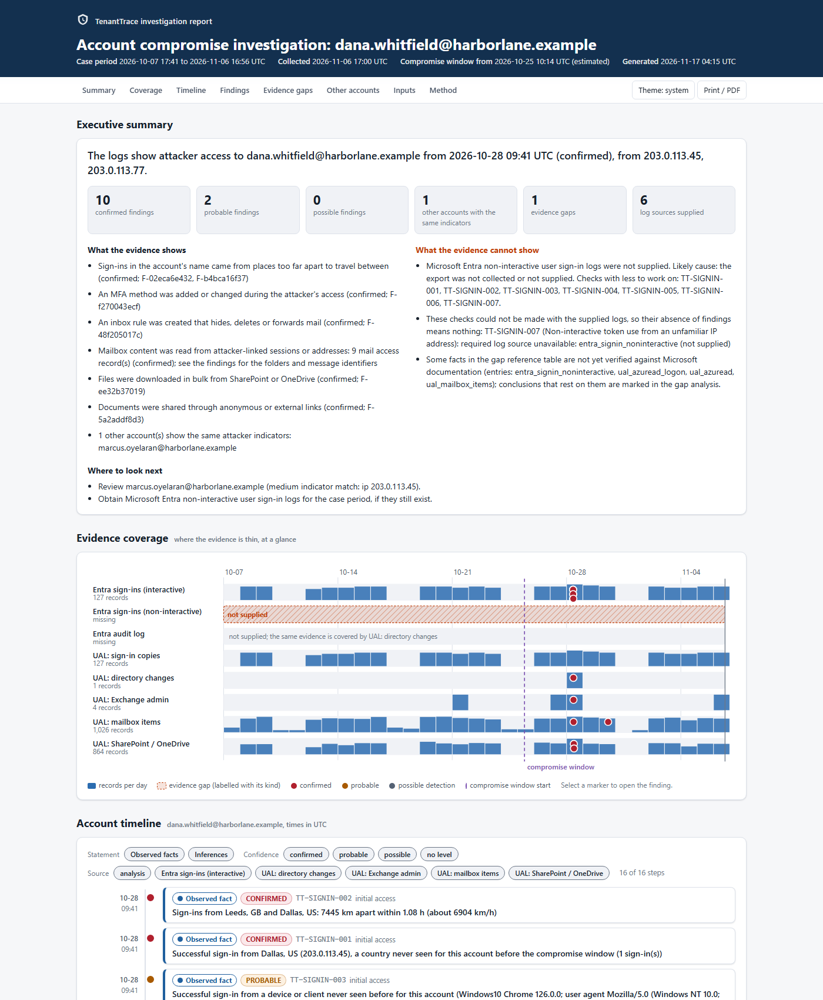
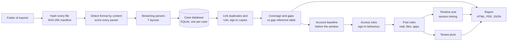
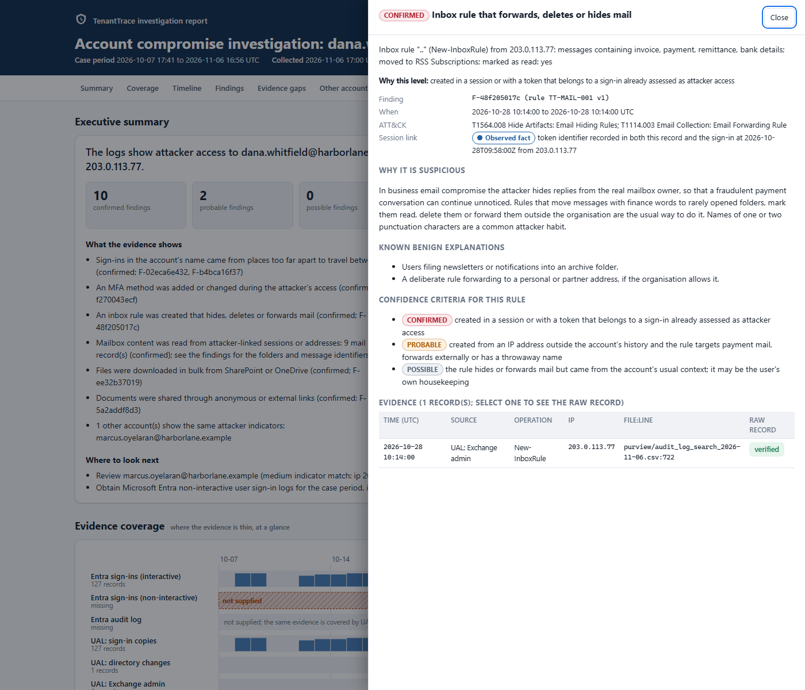
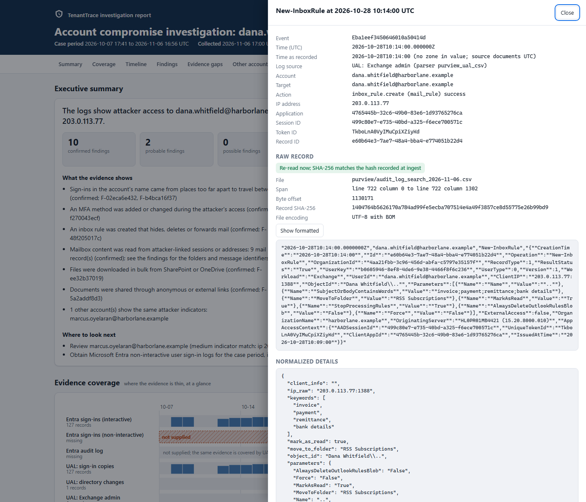

# TenantTrace

**Offline investigation of Microsoft 365 business email compromise and account takeover, with a
report you can defend.**

TenantTrace takes the audit and sign-in logs someone has already collected from a Microsoft 365
tenant and turns them into a clear account of what happened to one compromised user. Just as
important, it states plainly what the evidence **cannot** show: which logs were missing, cut short,
truncated or never audited, and which checks were therefore impossible to make.



## Contents

- [Why it exists](#why-it-exists)
- [What it does](#what-it-does)
- [Quick start](#quick-start)
- [How it works](#how-it-works)
- [Evidence gap analysis](#evidence-gap-analysis)
- [Detection rules and confidence](#detection-rules-and-confidence)
- [Timeline, session linking and pivot](#timeline-session-linking-and-pivot)
- [The report](#the-report)
- [Forensic handling](#forensic-handling)
- [Evaluation](#evaluation)
- [Performance](#performance)
- [Accuracy of formats and facts](#accuracy-of-formats-and-facts)
- [Running it on your own exports](#running-it-on-your-own-exports)
- [Project layout and development](#project-layout-and-development)
- [Limits](#limits)

## Why it exists

When a Microsoft 365 mailbox is taken over, the investigator receives large exports from several
places: Entra sign-in logs, the unified audit log, mailbox audit records, SharePoint and OneDrive
activity. They come in different shapes and encodings, they name the same things differently,
they repeat the same action in two logs, and nothing lines them up on one timeline. Analysts redo
the same filtering in every case.

Cloud logs also depend on licensing, audit configuration and retention. An absence of events does
not prove nothing happened, yet reports routinely say "no evidence of mailbox access" when mailbox
access was never being recorded. TenantTrace treats that gap as a first-class result.

## What it does

| Capability | What you get |
|---|---|
| **Normalization** | Seven export layouts read into one event schema (who, what, when, from where, which device, which session, which log). Times converted to UTC with the original kept. The audit log's copies of sign-ins are linked to the Entra records instead of counted twice. Every event points to its exact source record: file, line and column span, byte offset, SHA-256. Unrecognised records are counted and listed, never dropped. |
| **Evidence gap analysis** | Which sources were supplied and the period each covers; which are missing, truncated, cut by retention, quiet for an unexplained stretch, or present without the auditing that should fill them; the likely cause of each, reasoned from a versioned, cited reference table; and, for every detection, whether the data could have shown it at all. |
| **Detection** | 18 rules stored as YAML data: unfamiliar country, impossible travel, new device or client, legacy protocols, single-factor and token-replay sign-ins, password spraying, hiding inbox rules, forwarding, delegate and folder permissions, attacker-linked mail access, IMAP/POP collection, MFA and device registration, OAuth consent and app mail access, bulk downloads and external sharing. Each finding lists the exact records that triggered it. No numeric risk score. |
| **Account timeline** | One chronological story for the account. Every step is labelled **observed fact** or **inference**, and inferences say what they rest on. |
| **Tenant pivot** | Other accounts in the logs that share the attacker's IPs, sessions, tokens, user agents or application IDs, as leads for the next step. |
| **Reporting** | A self-contained HTML report (works from `file://`, makes no request), a PDF and a JSON export, with the inputs' hashes and the tool, rule set and reference table versions. |

Out of scope by design: log collection, real-time monitoring, machine learning, and anything other
than Microsoft 365 (the event schema leaves room for Google Workspace; nothing is built for it).

## Quick start

On Windows with Python 3.12 (64-bit):

```powershell
powershell -ExecutionPolicy Bypass -File scripts\demo.ps1
```

On a fresh clone this creates `.venv`, installs TenantTrace into it, generates the synthetic demo
case (a phished finance manager at the fictional Harbor Lane Logistics), runs the whole pipeline
and prints where `report.html`, `report.pdf` and `report.json` are. It took 34 seconds on a fresh
clone here, environment setup included.

The demo tells a complete story: an adversary-in-the-middle phishing sign-in from Dallas, the
stolen session replayed from Amsterdam 17 minutes later, a new authenticator app registered, an
inbox rule named `..` hiding payment mail in *RSS Subscriptions*, mailbox reads, 40 files
downloaded and 3 anonymous links created, internal phishing to two colleagues, one of whom signs
in from the attacker's address the next day. The export deliberately lacks the non-interactive
sign-in log, so the gap analysis has something real to say: token replay cannot be assessed.

## How it works



Each stage is also a subcommand (`ingest`, `coverage`, `analyze`, `report`) so it can be run and
inspected on its own; `tenanttrace run` does all of them. A case folder holds `manifest.json`,
`processing.log` (one JSON line per step), `case.sqlite`, `coverage.json`, `analysis.json` and
`report/`.

### Supported inputs

Formats are recognised by their content, never by file name: every parser scores a sample of the
file and the choice and reason are logged.

| Layout | Parser | Notes |
|---|---|---|
| Microsoft Purview audit search export (CSV, 4-column and the newer 8-column layout) | `purview_ual_csv` | the 8-column layout is not documented by Microsoft (see VERIFY.md) |
| `Search-UnifiedAuditLog \| Export-Csv` (UTF-16 or UTF-8, `#TYPE` line, unsorted rows) | `ps_ual_csv` | checks `ResultCount` against the rows actually present |
| Unified audit log JSON: wrapper objects or AuditData objects, array, JSON Lines, appended pages | `ual_json` | Microsoft-Extractor-Suite `Get-UAL`, Management Activity API, Hawk raw files |
| Hawk flattened `Simple_` and `Converted_` CSVs | `ual_flat_csv` | rebuilds AuditData; collector enrichment kept apart |
| Entra admin-centre sign-in download (CSV) | `entra_signin_csv` | header matched case-insensitively |
| Entra sign-ins as Graph `signIn` objects (JSON download, collectors) | `entra_signin_json` | interactive and non-interactive split per record |
| Entra sign-ins in the Azure Monitor diagnostic format | `entra_signin_azure_monitor` | tested on public Splunk attack_data samples |
| Entra directory audit (Graph `directoryAudit` JSON) | `entra_audit_json` | |

Collector layouts: **Microsoft-Extractor-Suite** (Invictus-IR) and **Hawk** (T0pCyber), as
documented from their source code in `docs/sources/collectors.md`.

## Evidence gap analysis

This is the part most reports leave out. TenantTrace reasons from
[`gap_reference.yaml`](src/tenanttrace/reference/gap_reference.yaml), a versioned table that
records, for each log source: what it records, which licences include it, default retention,
whether it is on by default, why it can be absent, the Microsoft documentation behind each
statement, the date it was checked and a `verified` flag. The report names the table version and
marks every gap that rests on an unverified entry.

How the reasoning works:

- **Sources live in containers.** All `ual_*` record types come from one audit log export, so they
  share its period: an export covering October with no MailItemsAccessed records points to mailbox
  auditing, not to the export.
- **Continuous versus sparse.** An active mailbox produces mail-access and sign-in records every
  working day, so their absence means something ("auditing absent"). Inbox-rule cmdlets and
  directory changes happen rarely, so their absence is normal and not reported.
- **Each source's own rhythm.** For every source TenantTrace learns how many records it normally
  produces at each hour of a weekday and of a weekend day. A silence, a late start or an early end
  is only reported when that rhythm predicts at least 10 records for it while the other sources
  kept their usual pace, so nights, weekends and tenant-wide quiet days are not flagged.
- **Retention.** When a source starts later than the others and its first surviving record fits
  a documented retention period, the gap names it: for example, sign-ins reaching back about 7
  days match "Microsoft Entra ID Free keeps these records for 7 days".
- **Truncation.** Exports that hit a documented row limit, PowerShell exports whose `ResultCount`
  exceeds the rows present, and files that end mid-record.
- **Alternatives and scope.** A missing Entra audit log is not a gap when the audit log's directory
  records carry the same evidence; an audit log export in which every record concerns one account
  is recognised as a per-user collection (such as Hawk's), and absent record types are attributed
  to that scope first.
- **Capability per rule.** For every detection the report says whether it ran, ran partially, or
  **could not be assessed**, with the reason, such as a source not supplied, auditing absent, less
  than 14 days of history, or no coordinates in the sign-in records. "Could not be assessed" is
  never shown as "nothing found".

In the demo the report says, in so many words, that non-interactive sign-ins were not supplied,
that token replay (TT-SIGNIN-007) could not be assessed, and that four reference entries are not
yet verified.

## Detection rules and confidence

Rules are YAML files in [`src/tenanttrace/rules/`](src/tenanttrace/rules/). The engine supports
single-event matches, thresholds, deviations from the account's own history, sequences and
impossible travel. A rule looks like this (abridged):

```yaml
id: TT-MAIL-001
title: Inbox rule that forwards, deletes or hides mail
kind: match
stage: post
attack:
  - {id: T1564.008, name: "Hide Artifacts: Email Hiding Rules"}
sources:
  any: [ual_exchange_admin, ual_mailbox_items]
select:
  all:
    - {field: action, in: [inbox_rule.create, inbox_rule.update]}
    - any:
        - {field: details.move_to_folder, contains_any_ci: [rss, archive, conversation history, junk]}
        - {field: details.delete_message, truthy: true}
        - {field: details.rule_name, regex: "^[^A-Za-z0-9]{1,4}$"}
why: ...
benign: [Users filing newsletters into an archive folder, ...]
confidence:
  - level: confirmed
    when: {ctx: session_or_token_flagged}
    reason: "created in a session or with a token that belongs to a sign-in already assessed as attacker access"
  - level: probable
    when: ...
  - level: possible
    when: true
```

**"Unusual" has a definition:** not seen for this account in the supplied logs before the
suspected compromise window. The window comes from the analyst (`--window-start`), or is estimated
from the earliest baseline-independent indicator minus 72 hours, and the report says which.

**Confidence has three fixed levels**, defined in [docs/CONFIDENCE.md](docs/CONFIDENCE.md) and
applied through each rule's data, with the reason shown beside every label:

| Level | Meaning |
|---|---|
| confirmed | the action is recorded and tied to attacker access by an identifier the logs themselves carry (a shared session or token ID, or a session replayed from an impossible location) |
| probable | the action is recorded and two or more independent indicators point to the attacker, but the link is correlation (same unfamiliar IP), not a recorded identifier |
| possible | a single indicator, or benign explanations remain about as plausible; a lead, not a conclusion |

Rules run in two stages: sign-in findings at probable or above mark attacker IPs, sessions and
tokens (never the account's own baseline addresses), which later mailbox, file and consent rules
use. A business trip at "possible" never makes the user's own mail reading look malicious.

All ATT&CK IDs were checked on attack.mitre.org (v20.1) and are listed in
[docs/sources/attack-techniques.md](docs/sources/attack-techniques.md); a test fails if a rule
uses an ID that is not on that list.

## Timeline, session linking and pivot

Activity is tied to the sign-in that produced it through the identifiers Microsoft documents as
linkable: the token identifier (`UniqueTokenId` and `uniqueTokenIdentifier`) and the session ID
(`AADSessionId` and `sessionId`). Such links are observed facts. Where a record carries neither,
a link by IP address and time is made only as a labelled inference. In the demo, 336 of the
account's records link through recorded identifiers.

The demo timeline reads:

1. 09:41 sign-in from Dallas, a country never seen for the account (observed, confirmed)
2. 09:58 *inference:* the same session used from Dallas and Amsterdam 17 minutes apart, consistent with a stolen session cookie (rests on the session ID recorded in both sign-ins)
3. 10:06 authenticator app registered in the attacker's session (observed, confirmed, linked by token ID)
4. 10:14 inbox rule `..` moving payment mail to RSS Subscriptions and marking it read
5. 10:20 mailbox items read; 10:45 40 files downloaded; 10:59 3 anonymous links
6. 11:30 two messages sent to colleagues; two days later a return visit and deleted sent items

The pivot then lists `marcus.oyelaran@harborlane.example`, who signed in from the AiTM proxy's
address the next day. Indicators that most of the tenant already used before the window (a
corporate proxy, a standard browser build) are excluded, so the pivot does not list everyone.

## The report

The HTML report is the frontend: one file, no CDN, no fonts or scripts from anywhere, and a
Content-Security-Policy that forbids every connection. It is built from TypeScript with Vite and
committed inside the Python package, so users never need Node; CI rebuilds it and fails if the
committed copy differs from its source.

- **Coverage chart:** one lane per log source across the case period, daily volume as bars, gaps
  shaded and labelled with their kind, detections overlaid by confidence, and the compromise
  window marked.
- **Interactive timeline:** filter by source, confidence and statement type; observed facts and
  inferences look different (solid versus dashed, labelled).
- **Down to the raw record:** select a detection or step to see its evidence, then any record to
  see its exact original text, file, line and column span and SHA-256, re-read and re-hashed when
  the report was built.
- Light and dark themes, a print layout, and keyboard access (Enter opens a step, Escape closes).

| Finding with its evidence | Raw record, re-verified |
|---|---|
|  |  |

These screenshots were captured from `file://` in headless Edge with name resolution and proxying
disabled. `scripts/verify_report_browser.mjs` repeats that check with real mouse and keyboard
input: it clicks a coverage-chart marker, then the finding's first evidence row, confirms the raw
record shows "SHA-256 matches", checks Escape and Enter, and verifies that the page made no
network request.

## Forensic handling

- Inputs are opened read-only, hashed with SHA-256 before parsing, hashed again afterwards (a
  change fails the run), and listed in `manifest.json` with parser, encoding and record counts.
- Every step is written to `processing.log`.
- The same inputs, rule set and reference table give the same findings: event and finding IDs
  are derived from content, and a test runs a case twice and compares the results.
- The tool is offline. The CLI installs a Python audit hook that blocks socket creation, connection
  and name resolution for the whole process; a test runs the full pipeline with sockets patched to
  fail. Locations come only from the logs' own fields (or an analyst's offline IP database).
- Records the parser cannot read go to an `unrecognised` table with their line span, hash and
  reason; operations TenantTrace does not map are kept as events of category `other` and counted
  per operation. Per file, records total = parsed + unrecognised + malformed.

## Evaluation

There is no real tenant behind this project, so a scenario generator (`ttcorpus`) writes exports
in each supported layout from a scenario description, together with a ground-truth file. The
generator was written from the documented layouts separately from the parsers, may not import the
tool (a test enforces this), and is checked field for field against a third transcription of the
documentation (`docs/sources/layouts.yaml`).

The corpus has 13 scenarios: 4 attacks that differ in technique and order (AiTM phishing, password
spray with IMAP and forwarding, consent phishing, impossible travel with delegation and external
sharing), 3 benign baselines built around common false alarms (a business trip and a new phone, an
internal forwarding rule and a VPN user, an administrator's bulk migration), 5 degraded copies (sign-in
logs removed, audit log truncated, 7-day retention, mailbox auditing absent, two days missing), and
one Hawk collection. `tteval` reruns everything and regenerates
[eval/results.md](eval/results.md):

| Measure | Result |
|---|---|
| Expected findings detected | 56 / 56 |
| False positives in attack and degraded cases | 0 |
| False positives in benign cases | 0 |
| Benign findings, all at "possible" within the rules the scenario allows | 8 |
| Rules correctly reported as not assessable | 16 / 16 |
| Expected evidence gaps reported (unexpected gaps) | 14 / 14 (0) |
| Expected pivot accounts found (extra accounts) | 12 / 12 (0) |

**What these numbers mean, and what they do not.** They show that the implementation does what its
specification says on data generated from the same documentation. They are not a measure of how
the tool performs on real incidents: the scenarios were written by the same author as the rules,
real exports contain behaviour and formatting no generator anticipates, and several layouts are
undocumented by Microsoft (see below). Treat them as regression tests, not as detection rates.

## Performance

Measured with `python scripts/perf_run.py` ([docs/PERFORMANCE.md](docs/PERFORMANCE.md)): a
1,240 MB Purview CSV with 1,000,000 synthetic records for 511 accounts, plus the demo exports, on
a 20-logical-CPU Intel machine with Windows 11 and Python 3.12:

| Stage | Seconds |
|---|---|
| ingest (1,002,149 records, none lost) | 87.1 |
| coverage | 9.6 |
| analyze | 18.0 |
| report (HTML, PDF, JSON) | 0.9 |
| **total** | **115.6** |

Peak memory of the whole process stayed at 56 MB, because parsing streams the input and keeps only a
bounded buffer. The case database was 1.29 GB.

## Accuracy of formats and facts

A forensic tool that guesses at field names produces confident wrong reports. Every format, field,
limit, retention period, licence statement and ATT&CK ID was researched from Microsoft Learn,
Microsoft's documentation repositories, the collectors' source code and attack.mitre.org, and
recorded in [docs/sources/](docs/sources/) with a CONFIRMED / UNCONFIRMED tag and the URL.

What Microsoft does not document (for example the current Purview CSV header, the Entra CSV header,
how inbox-rule parameters are serialised, and whether Free tenants see non-interactive sign-ins)
is implemented from best knowledge, marked `verified: false` where it lives in the reference
table, and listed in [docs/VERIFY.md](docs/VERIFY.md) with what to check in a real export.

Public samples: four small Splunk attack_data files (Apache-2.0, attribution and licence in
`samples/third_party/`) are parsed by the tests.

## Running it on your own exports

```bash
pip install -e .
tenanttrace run path/to/exports --user victim@yourtenant.com --case path/to/case --collected-at 2026-11-06T17:00:00Z
```

- Put every export for the case in one folder (sub-folders are fine, so collector output can be
  dropped in as is). Keep the case folder outside it.
- `--collected-at` lets the gap analysis reason about retention; without it the latest record is used.
- `--window-start` sets the suspected compromise start if you know it.
- `--ipdb` names an offline IP location CSV you already have; nothing is ever downloaded.
- Run the stages separately with `tenanttrace ingest`, `coverage`, `analyze` and `report`.
- Check `manifest.json`: if a file shows `not recognised` or records as unrecognised, the
  processing log says why. Real exports placed in `samples/real/` are git-ignored.

## Project layout and development

```
src/tenanttrace/    the tool: ingest/, coverage/, rules/ (YAML), reference/ (gap table), report/
src/ttcorpus/       scenario generator and export writers (never imports the tool)
src/tteval/         evaluation harness
report-ui/          TypeScript source of the HTML report template
tests/              136 tests: parsers, gaps, every rule, timeline, report, determinism, offline
docs/               DECISIONS, PROGRESS, CONFIDENCE, VERIFY, PERFORMANCE, sources/, screenshots/
scripts/            demo.ps1, perf_run.py, verify_report_browser.mjs
```

```bash
pip install -e ".[dev]"
python -m pytest -q                 # the full suite
tteval                              # rerun the evaluation, rewrite eval/results.md
cd report-ui && npm ci && npm run build   # rebuild the report template (only when changing the UI)
```

CI runs the tests on Windows and Linux, rebuilds the report template and compares it with the
committed copy, and clicks through the demo report in the runner's Chrome with networking disabled.

Design decisions, with the alternatives considered, are logged in
[docs/DECISIONS.md](docs/DECISIONS.md).

## Limits

- Results come from generated data; nothing has been run against a real tenant's exports yet.
  [docs/VERIFY.md](docs/VERIFY.md) lists what to check first.
- Sign-in CSV rows are classed as interactive or non-interactive from the file name when no column
  says so (Microsoft documents no such column).
- Impossible travel needs coordinates, which the Entra JSON download has and the CSV download does
  not; the report says so when it applies.
- The PDF uses core fonts and transliterates characters outside Latin-1; the JSON keeps exact text.
- Collector enrichment (such as Hawk's country lookup) is kept but never used as location.
